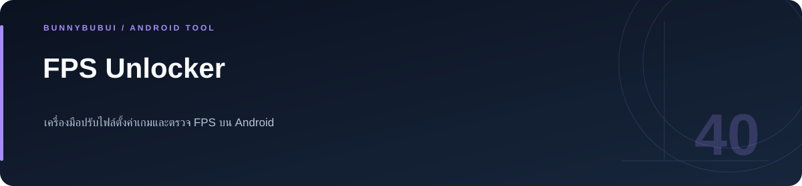

<p align="center">
  
</p>

<h1 align="center">Android FPS Configuration Tool</h1>

<p align="center">Game configuration scanning, backups and an FPS overlay</p>

<p align="center">
     
</p>

<p align="center"><a href="#overview">ภาพรวม</a> · <a href="#features">ความสามารถ</a> · <a href="#start">เริ่มใช้งาน</a> · <a href="#structure">โครงสร้าง</a> · <a href="#validation">ตรวจสอบงาน</a></p>

<a id="overview"></a>

## ภาพรวม

เครื่องมือ Android สำหรับสำรวจและปรับค่า FPS ในไฟล์ตั้งค่าเกม มีการสำรองข้อมูลและ overlay สำหรับตรวจผล ใช้ Kotlin, Jetpack Compose และ Shizuku

<a id="features"></a>

## ความสามารถที่มีใน source

| ส่วนงาน | รายละเอียด | อ้างอิง |
|---|---|---|
| **Configuration editing** | ค้นหาไฟล์ตั้งค่าและสำรองก่อนแก้ไข | [ดู source](app/src/main/java/com/fpsunlocker/tool/data/) |
| **File access** | ใช้ Shizuku UserService สำหรับเข้าถึงไฟล์ | [ดู source](app/src/main/java/com/fpsunlocker/tool/shizuku/) |
| **FPS overlay** | แสดงผลการวัดผ่าน overlay | [ดู source](app/src/main/java/com/fpsunlocker/tool/overlay/) |
| **Interface** | Kotlin และ Jetpack Compose | [ดู source](app/src/main/java/com/fpsunlocker/tool/ui/) |

<a id="start"></a>

## เริ่มต้นใช้งาน

**สิ่งที่ต้องมี:** JDK 17 และ Android SDK Platform 35; การใช้งานแอปต้อง Android 11+ และ Shizuku

```sh
./gradlew assembleDebug
```

ดาวน์โหลด test artifact จาก Actions หรือ build ใน Android Studio ส่วน release ใช้ signing key ส่วนตัวตาม `docs/SIGNING.md`

<a id="structure"></a>

## โครงสร้างที่ควรเริ่มอ่าน

| ตำแหน่ง | หน้าที่ |
|---|---|
| [app/](app) | พื้นที่งาน / ไฟล์ประกอบ |
| [gradle/](gradle) | พื้นที่งาน / ไฟล์ประกอบ |

<a id="validation"></a>

## คำสั่งและผลตรวจ

ใช้ Gradle ตามคำสั่งในหัวข้อเริ่มต้นและคู่มือ ดูผล workflow ปัจจุบันได้ในแท็บ [Actions](https://github.com/BunnyBubui/FpsUnlocker/actions)

<a id="scope"></a>

## ขอบเขตของงาน

ผล FPS ขึ้นกับอุปกรณ์ เกม และค่าที่เกมยอมรับ; debug APK เป็นไฟล์ทดสอบและอาจติดตั้งทับ build เดิมไม่ได้

<a id="reading"></a>

## อ่านต่อ

- [English user guide](docs/USER_GUIDE.en.md) · [คู่มือภาษาไทย](README.th.md)
- [คู่มือรายละเอียดเดิม](docs/USER_GUIDE.en.md)
- [บันทึกการเตรียม source](docs/CLEANUP.md)
- [การลงนาม Android](docs/SIGNING.md)

<a id="license"></a>

## สัญญาอนุญาต

อ่านเงื่อนไขใน [LICENSE](LICENSE) ก่อนนำ source ไปใช้งานหรือเผยแพร่ต่อ


---

<p align="center"><a href="https://github.com/BunnyBubui">BunnyBubui</a> · <a href="https://github.com/BunnyBubui/test">Software Portfolio</a></p>
